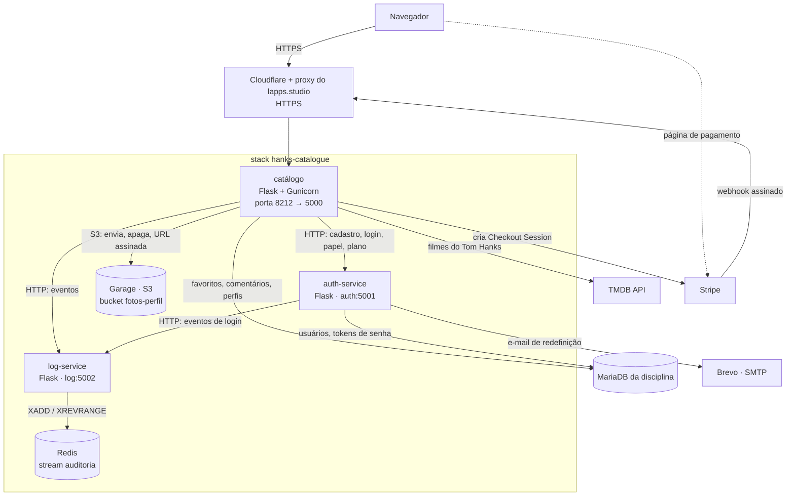
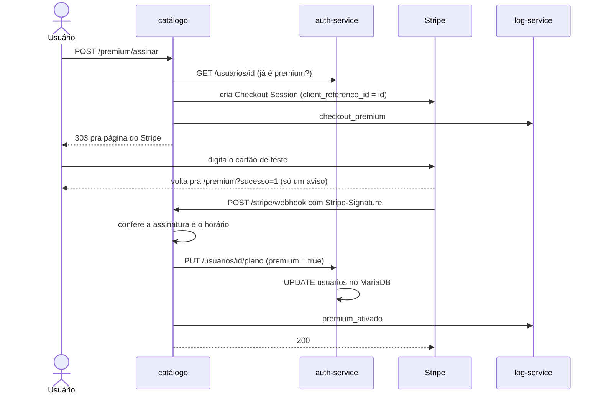
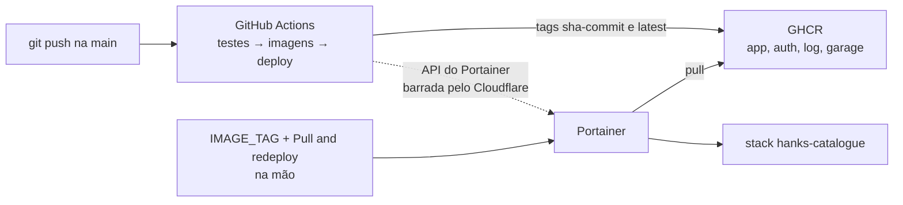
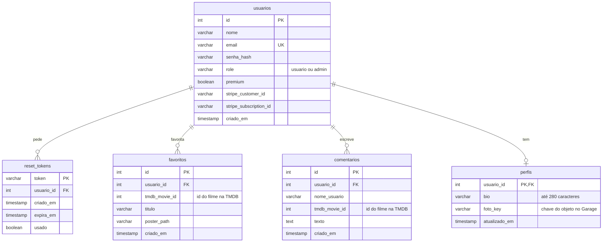

# Documentação do Tom Hanks Catalog

Documentação do sistema escrita no fim da série, relendo o código e os commits dos últimos dois
meses, como se fosse um sistema herdado sem documento nenhum. Tudo aqui descreve o que o código faz
hoje; cada regra de negócio aponta pra linha de onde ela foi tirada.

A classificação de cada peça em SaaS, PaaS ou IaaS está no [README](README.md#saas-paas-e-iaas).

1. [Especificação](#1-especificação)
2. [Arquitetura](#2-arquitetura)
3. [Regras de negócio](#3-regras-de-negócio)
4. [Modelo de dados](#4-modelo-de-dados)

---

## 1. Especificação

O Tom Hanks Catalog é um catálogo da filmografia do Tom Hanks em que cada pessoa tem uma conta,
favorita filmes, comenta e monta um perfil com foto. Existe um plano pago (Premium) e um papel de
administrador que modera comentários e consulta o log de auditoria.

### Quem usa

| Perfil | O que pode fazer |
|---|---|
| Visitante (sem login) | Criar conta, entrar e pedir a recuperação de senha. Mais nada: qualquer outra página manda pro login. |
| Usuário, plano gratuito | Ver o catálogo, favoritar até 5 filmes, comentar, apagar os próprios comentários, ver qualquer perfil e editar o próprio. |
| Usuário Premium | O mesmo, com favoritos sem limite e o selo ★ Premium no perfil. |
| Administrador (`admin`) | Tudo o que um usuário faz, mais apagar comentário de qualquer pessoa e consultar o log de auditoria. |

Papel e plano são independentes: um admin pode estar no plano gratuito ou no Premium. Não existe
tela pra tornar alguém admin; toda conta nasce `usuario` e o papel só muda direto no banco.

### Cadastro e login

- Em **/cadastro** a pessoa informa nome, e-mail e senha. Com tudo certo, volta pra tela de login;
  se o e-mail já tiver conta, aparece "E-mail já cadastrado."
- Em **/login** entra com e-mail e senha e cai no catálogo. Errando qualquer um dos dois, a mensagem
  é sempre "E-mail ou senha inválidos.", sem dizer qual estava errado.
- **Sair**, no topo de todas as páginas, encerra a sessão.

### Recuperação de senha

- Em **/esqueci-senha** a pessoa digita o e-mail e sempre vê a mesma resposta: "Se esse e-mail
  estiver cadastrado, você vai receber um link em instantes."
- Se a conta existir, chega um e-mail com um link pra **/resetar-senha**, válido por 30 minutos e
  que só funciona uma vez. Lá ela escolhe a senha nova e volta pro login.

### Catálogo

A página inicial (depois do login) lista os filmes do Tom Hanks buscados na hora na API do TMDB: do
lançamento mais recente pro mais antigo, só os que têm pôster, 20 por página. Cada filme mostra
pôster, título, data de lançamento, sinopse, o botão de favoritar e os comentários. O topo tem
**Meu perfil**, **Seja Premium** (ou **★ Premium** pra quem assina), **Logs** (só pra admin) e
**Sair**; embaixo, **Anterior** / **Próxima**.

### Favoritos

- O botão alterna entre **☆ Favoritar** e **★ Favoritado**.
- No plano gratuito aparece uma faixa "Plano gratuito: X de 5 favoritos". Chegando a 5, os filmes que
  ainda não são favoritos ficam com o botão bloqueado em "Limite do plano gratuito". Tirar um
  favorito continua liberado.
- Os favoritos aparecem no perfil da pessoa, do mais recente pro mais antigo.

### Comentários

- Cada filme tem os comentários de todos os usuários, o mais novo primeiro. O nome do autor leva pro
  perfil dele.
- Qualquer usuário logado comenta pelo campo embaixo do filme.
- O botão **Apagar** aparece nos próprios comentários; pra admin, aparece em todos.

### Perfil e avatar

- **/perfil** leva pro próprio perfil; **/perfil/&lt;id&gt;** abre o de qualquer usuário.
- O perfil mostra a foto (ou a inicial do nome, se não tiver), o nome, o selo ★ Premium quando for
  o caso, a bio, quantos filmes a pessoa favoritou e a grade com os pôsteres.
- Só no próprio perfil aparece o formulário **Editar perfil**: bio de até 280 caracteres e foto JPG,
  PNG ou WebP de até 2 MB. Dá pra salvar só a bio e manter a foto.

### Plano Premium

- **/premium** mostra o preço (R$ 9,90/mês), os benefícios e o botão **Assinar com Stripe**.
- O botão leva pra página de pagamento do Stripe (em modo de teste); o cartão é digitado lá.
- Ao voltar, a página avisa que o pagamento foi enviado e que a confirmação chega em alguns
  segundos. O plano fica ativo quando o Stripe confirma, e aí a página mostra "Sua assinatura está
  ativa".
- Quem desiste no Stripe volta com "Pagamento cancelado. Nada foi cobrado."
- Não há botão de cancelar a assinatura no catálogo: o cancelamento acontece no Stripe, e o catálogo
  volta a pessoa pro plano gratuito quando o Stripe avisa.

### Log de auditoria (admin)

- O link **Logs** leva pra **/admin/logs**, com os últimos 50 eventos, do mais recente pro mais
  antigo: horário (UTC), usuário, ação, serviço que registrou, IP e detalhes. `?n=` muda a quantidade
  (até 500).
- Entram no log: login (certo e errado), logout, favoritar e desfavoritar, comentar, apagar
  comentário, moderação, edição de perfil, abertura de checkout, plano ativado/cancelado, webhook
  recusado e toda tentativa negada por permissão. A lista completa, com quem registra cada uma, está
  no [README](README.md#log-de-auditoria).

---

## 2. Arquitetura

### Serviços e conexões

| Serviço | O que faz | Porta | Fala com |
|---|---|---|---|
| **catálogo** (`app/`) | Único ponto de entrada. Páginas, catálogo, favoritos, comentários, perfil, premium e a consulta do log. | `8212` no host → `5000` | auth, log, Garage, MariaDB, TMDB, Stripe |
| **auth-service** | Cadastro, login, papel e plano de cada usuário, recuperação de senha. Único que escreve em `usuarios`. | `5001`, só na rede do Docker | MariaDB, log, SMTP |
| **log-service** | Recebe os eventos de auditoria e devolve os últimos N. Único que fala com o Redis. | `5002`, só na rede do Docker | Redis |
| **Redis** | Guarda o stream `auditoria`, com `appendonly` e volume próprio. | `6379`, só na rede do Docker | — |
| **Garage** | Object storage compatível com S3 (no lugar do MinIO) pras fotos de perfil. Bucket privado. | `3900`, só na rede do Docker | — |
| **MariaDB** | Banco da disciplina, fora da stack. Tabelas do auth e do catálogo no mesmo schema. | — | — |
| **TMDB**, **Stripe**, **Brevo** | Serviços externos: dados dos filmes, pagamento, e-mail. | — | — |

Algumas decisões que aparecem no desenho:

- **Só o catálogo tem porta publicada.** Auth, log, Redis e Garage só existem na rede padrão do
  projeto no Docker. Até a foto de perfil chega no navegador pela rota `/fotos` do catálogo, que só
  repassa a URL assinada pro Garage.
- **Permissão é perguntada na hora (Padrão A).** Antes de deixar alguém moderar um comentário,
  abrir o log ou passar do limite de favoritos, o catálogo chama `GET /usuarios/<id>` no auth-service
  e usa o papel e o plano atuais, não o que ficou na sessão do login.
- **O log não derruba ninguém.** Catálogo e auth mandam o evento com timeout de 2 segundos e ignoram
  a falha: com o log-service fora, o evento se perde, mas o usuário não percebe.
- **Cada tabela tem um dono.** O catálogo nunca lê nem escreve em `usuarios`: quando precisa do nome,
  papel ou plano de alguém, ou de mudar o plano, pede pro auth-service.

### Exemplo de fluxo: assinatura do Premium

É o fluxo que passa por mais peças, incluindo um SaaS que chama o sistema de volta:

### Deploy

Nada é buildado no servidor: o compose de produção só puxa as imagens do GHCR com a tag do commit.
Os detalhes (e por que o último passo ainda é um clique) estão no [README](README.md#cicd).

---

## 3. Regras de negócio

Tiradas lendo o código, no formato "se X, então Y". O link de cada uma vai pra linha onde ela está.

### Cadastro e login

1. **Se** nome, e-mail ou senha vierem vazios, **então** o cadastro é recusado ("Preencha todos os
   campos."). — [`app/auth.py:48`](app/auth.py#L48), [`auth-service/app.py:142`](auth-service/app.py#L142)
2. **Se** o e-mail já tiver conta, **então** o cadastro é recusado com `409`. O e-mail é comparado
   sem espaços nas pontas e em minúsculas, então `Joao@Email.com ` e `joao@email.com` são a mesma
   conta. — [`auth-service/app.py:139`](auth-service/app.py#L139), [`:152`](auth-service/app.py#L152)
3. **Se** a conta é criada pelo cadastro, **então** o papel é sempre `usuario`, não importa o que
   venha na requisição. — [`auth-service/app.py:155-156`](auth-service/app.py#L155-L156)
4. **Se** uma senha é cadastrada ou trocada, **então** só o hash dela vai pro banco. —
   [`auth-service/app.py:145`](auth-service/app.py#L145), [`:487`](auth-service/app.py#L487)
5. **Se** o e-mail não existe ou a senha não bate, **então** o login falha com a mesma mensagem nos
   dois casos e o evento `login_falhou` é registrado (com o id da conta, quando o e-mail existe). —
   [`auth-service/app.py:220-227`](auth-service/app.py#L220-L227)
6. **Se** o login dá certo, **então** a sessão anterior é apagada e a nova guarda só id, nome e
   papel. — [`app/auth.py:89-92`](app/auth.py#L89-L92)
7. **Se** alguém sem sessão abre o catálogo, um perfil, o premium ou o log, **então** é mandado pro
   `/login`. — [`app/auth.py:29-36`](app/auth.py#L29-L36)

### Recuperação de senha

8. **Se** alguém pede a recuperação, **então** a resposta é a mesma exista ou não a conta, pra não
   revelar quais e-mails estão cadastrados. — [`app/auth.py:121-125`](app/auth.py#L121-L125),
   [`auth-service/app.py:413-419`](auth-service/app.py#L413-L419)
9. **Se** o e-mail tem conta, **então** é gerado um token aleatório que vale 30 minutos e o link vai
   por e-mail. — [`auth-service/app.py:43`](auth-service/app.py#L43), [`:402-410`](auth-service/app.py#L402-L410)
10. **Se** o token não existe, já foi usado ou passou dos 30 minutos, **então** a troca de senha é
    recusada, com uma mensagem pra cada caso. — [`auth-service/app.py:480-485`](auth-service/app.py#L480-L485)
11. **Se** a senha é trocada pelo link, **então** o token é marcado como usado na mesma hora. —
    [`auth-service/app.py:487-494`](auth-service/app.py#L487-L494)

### Catálogo

12. **Se** um filme da TMDB não tem pôster, **então** ele não aparece no catálogo. —
    [`app/tmdb.py:37`](app/tmdb.py#L37)
13. **Se** a página pedida (`?page=`) é menor que 1 ou maior que a última, **então** o catálogo mostra
    a primeira ou a última. — [`app/movies.py:38-40`](app/movies.py#L38-L40)

### Favoritos e plano

14. **Se** o filme já está nos favoritos, **então** clicar de novo tira ele; desfavoritar é sempre
    liberado, em qualquer plano. — [`app/movies.py:101-106`](app/movies.py#L101-L106)
15. **Se** o usuário já tem 5 favoritos e não é premium, **então** favoritar um filme novo dá `403`,
    mesmo chamando a rota direto (o botão desabilitado é só aparência). —
    [`app/movies.py:14`](app/movies.py#L14), [`:116-117`](app/movies.py#L116-L117)
16. **Se** o usuário é premium, **então** não há limite de favoritos. —
    [`app/movies.py:116`](app/movies.py#L116)
17. **Se** o usuário acabou de assinar ou cancelar, **então** a mudança vale na hora, sem relogar: o
    plano é perguntado ao auth-service a cada vez, não lido da sessão. —
    [`app/movies.py:24-29`](app/movies.py#L24-L29)
18. **Se** o auth-service não responde na hora de conferir o plano, **então** vale o plano gratuito.
    — [`app/movies.py:28-29`](app/movies.py#L28-L29)
19. **Se** a assinatura é cancelada, **então** os favoritos que já existem ficam, mas um novo só entra
    quando o total cair abaixo de 5. — [`app/movies.py:116`](app/movies.py#L116),
    [`app/premium.py:126-135`](app/premium.py#L126-L135)

### Comentários

20. **Se** o comentário está vazio (ou só tem espaços), **então** nada é gravado. —
    [`app/movies.py:142`](app/movies.py#L142)
21. **Se** quem pede pra apagar é o autor, **então** o comentário é apagado e vai pro log como
    `apagar_comentario`. — [`app/movies.py:181`](app/movies.py#L181), [`:189-190`](app/movies.py#L189-L190)
22. **Se** quem pede não é o autor, **então** só apaga se o auth-service disser, naquele momento, que
    a pessoa é admin; senão `403`. Apagado por admin vai pro log como `moderar_comentario`, com o id
    do autor. — [`app/movies.py:182-183`](app/movies.py#L182-L183), [`:191-195`](app/movies.py#L191-L195)
23. **Se** o auth-service não responde nessa checagem, **então** a pessoa é tratada como não-admin. —
    [`app/movies.py:17-21`](app/movies.py#L17-L21), [`app/auth.py:19-26`](app/auth.py#L19-L26)
24. **Se** o comentário não existe, **então** a resposta é `404`. —
    [`app/movies.py:174-175`](app/movies.py#L174-L175)

### Perfil e avatar

25. **Se** o usuário está logado, **então** vê o perfil de qualquer outro. —
    [`app/perfil.py:102-105`](app/perfil.py#L102-L105)
26. **Se** o id do perfil na URL é diferente do usuário da sessão, **então** a edição é negada com
    `403`, inclusive pra admin. O id da URL só é conferido, nunca decide de quem é o perfil salvo. —
    [`app/perfil.py:113-114`](app/perfil.py#L113-L114)
27. **Se** a bio passa de 280 caracteres, **então** nada é salvo. — [`app/perfil.py:117`](app/perfil.py#L117)
28. **Se** a foto passa de 2 MB, **então** é recusada; **se** a requisição inteira passa de 5 MB,
    **então** o Flask corta antes de chegar na rota (`413`). — [`app/perfil.py:126`](app/perfil.py#L126),
    [`app/__init__.py:15`](app/__init__.py#L15)
29. **Se** os primeiros bytes do arquivo não são de JPG, PNG ou WebP, **então** a foto é recusada; a
    extensão e o `Content-Type` mandados pelo navegador não contam. —
    [`app/perfil.py:20-29`](app/perfil.py#L20-L29), [`:133-137`](app/perfil.py#L133-L137)
30. **Se** uma foto nova é enviada, **então** ela ganha uma chave nova (`perfis/<id>/<uuid>.<ext>`) e
    a antiga só é apagada do Garage depois que o banco já aponta pra nova. —
    [`app/perfil.py:140`](app/perfil.py#L140), [`:164-168`](app/perfil.py#L164-L168)
31. **Se** o usuário salva só a bio, **então** a foto atual continua. —
    [`app/perfil.py:155-159`](app/perfil.py#L155-L159)
32. **Se** o Garage falha ao receber a foto, **então** nada muda no banco e a resposta é `503`. —
    [`app/perfil.py:141-146`](app/perfil.py#L141-L146)
33. **Se** alguém abre um perfil com foto, **então** recebe uma URL assinada que vale 10 minutos;
    vencida ou adulterada, o Garage responde `403`. — [`app/storage.py:6`](app/storage.py#L6),
    [`:46-54`](app/storage.py#L46-L54), [`app/perfil.py:186-199`](app/perfil.py#L186-L199)

### Plano Premium (Stripe)

34. **Se** o usuário já é premium, **então** "Assinar" não abre outro checkout. —
    [`app/premium.py:64-65`](app/premium.py#L64-L65)
35. **Se** o usuário volta do Stripe pra `/premium?sucesso=1`, **então** só aparece um aviso: essa URL
    não ativa nada, qualquer um pode abri-la na mão. — [`app/premium.py:27`](app/premium.py#L27)
36. **Se** o webhook chega sem `Stripe-Signature` válida, ou com horário de mais de 5 minutos,
    **então** é recusado com `400` e vai pro log como `webhook_recusado`. —
    [`app/premium.py:96-105`](app/premium.py#L96-L105)
37. **Se** chega `checkout.session.completed` com `payment_status = paid`, **então** o usuário do
    `client_reference_id` vira premium e o banco guarda os IDs do cliente e da assinatura no Stripe. —
    [`app/premium.py:113-124`](app/premium.py#L113-L124), [`auth-service/app.py:349-353`](auth-service/app.py#L349-L353)
38. **Se** chega `customer.subscription.deleted`, **então** o usuário dos `metadata` da assinatura
    volta pro gratuito; o id da assinatura é apagado e o do cliente fica. —
    [`app/premium.py:126-135`](app/premium.py#L126-L135), [`auth-service/app.py:339`](auth-service/app.py#L339)
39. **Se** o auth-service não consegue gravar o plano, **então** o webhook responde `503` e o Stripe
    manda o mesmo evento de novo depois; gravar o mesmo plano duas vezes não muda nada. —
    [`app/premium.py:116-119`](app/premium.py#L116-L119)

### Auditoria

40. **Se** qualquer rota do catálogo responde `403`, **então** o evento `acesso_negado` é registrado
    com o método e o caminho. — [`app/__init__.py:42-45`](app/__init__.py#L42-L45)
41. **Se** o log-service está fora do ar, **então** a ação do usuário segue normalmente e o evento se
    perde. — [`app/auditoria.py:19-34`](app/auditoria.py#L19-L34), [`auth-service/auditoria.py`](auth-service/auditoria.py)
42. **Se** um evento chega sem `acao`, **então** o log-service recusa com `400`. —
    [`log-service/app.py:144`](log-service/app.py#L144)
43. **Se** um serviço manda um evento, **então** o horário gravado é o do log-service na chegada (UTC),
    não o de quem mandou, pra todos ficarem na mesma linha do tempo. —
    [`log-service/app.py:152`](log-service/app.py#L152)
44. **Se** quem abre `/admin/logs` não é admin (perguntado ao auth-service na hora), **então** `403`.
    — [`app/movies.py:203-204`](app/movies.py#L203-L204)
45. **Se** `?n=` vem fora de 1 a 500, **então** é ajustado pro limite mais próximo; sem `n`, são 50. —
    [`app/movies.py:206`](app/movies.py#L206), [`log-service/app.py:185`](log-service/app.py#L185)
46. **Se** a requisição passou pelo proxy do servidor, **então** o IP registrado é o primeiro do
    `X-Forwarded-For`. — [`app/auditoria.py:7-12`](app/auditoria.py#L7-L12)

### O que a leitura do código mostrou fora das regras

Coisas que nenhuma regra acima cobre e que só apareceram lendo o código com calma:

- **Pedir outro link de senha não invalida os anteriores.** Cada pedido só insere um token novo;
  os antigos continuam valendo até completar os 30 minutos deles.
- **Trocar a senha não encerra sessões abertas.** A sessão é um cookie assinado do Flask, sem
  registro no servidor, então quem já estava logado continua logado.
- **A tela usa o papel da sessão; o backend, não.** O botão "Apagar" e o link "Logs" aparecem conforme
  o `role` gravado no login ([`app/movies.py:64`](app/movies.py#L64)), enquanto a decisão de verdade
  pergunta ao auth-service. Se o papel de alguém mudar, a tela fica desatualizada até a pessoa
  relogar, mas o que ela consegue fazer já muda na hora.
- **O limite de favoritos não está numa transação.** A contagem e o `INSERT` são comandos separados;
  duas requisições exatamente ao mesmo tempo com 4 favoritos poderiam passar as duas.

---

## 4. Modelo de dados

O sistema guarda dados em três lugares: o **MariaDB** (tabelas), o **Redis** (log de auditoria) e o
**Garage** (fotos). Os filmes e os pagamentos ficam fora, na TMDB e no Stripe.

### Tabelas no MariaDB

| Tabela | Dono | Observações |
|---|---|---|
| `usuarios` | auth-service | `email` único. `role` e `premium` ficam lado a lado: papel e plano são atributos do usuário. Do Stripe, só os IDs do cliente e da assinatura. |
| `reset_tokens` | auth-service | Um usuário pode ter vários tokens; cada um tem a própria validade e o `usado`. |
| `favoritos` | catálogo | `UNIQUE (usuario_id, tmdb_movie_id)`: o mesmo filme não entra duas vezes pra mesma pessoa. Guarda uma cópia do título e do pôster pra montar o perfil sem chamar a TMDB. |
| `comentarios` | catálogo | `nome_usuario` é copiado da sessão na hora do comentário, então a lista de comentários sai sem consultar o auth-service. |
| `perfis` | catálogo | Um por usuário, no máximo (a chave primária é o próprio `usuario_id`). A linha só nasce na primeira vez que a pessoa salva o perfil. |

As tabelas dos dois serviços estão no mesmo schema (o banco da disciplina é um só por aluno), por
isso as chaves estrangeiras atravessam de um serviço pro outro. A separação é por quem escreve: o
catálogo nunca toca em `usuarios` nem em `reset_tokens`.

### As entidades do enunciado

| Entidade | Onde fica | Por quê |
|---|---|---|
| Usuário | tabela `usuarios` | — |
| Filme | **não tem tabela.** Vem da API do TMDB a cada acesso; `favoritos` e `comentarios` guardam só o `tmdb_movie_id`. | Título, sinopse e pôster nunca ficam desatualizados, e não existe acervo pra manter. |
| Favorito | tabela `favoritos` | — |
| Log | Redis Stream `auditoria` | Só se acrescenta, nunca se altera; o próprio Redis gera um ID por evento a partir do horário, então a ordem vem de graça. |
| Sessão premium | **não tem tabela.** A Checkout Session e a assinatura existem no Stripe; aqui ficam `premium`, `stripe_customer_id` e `stripe_subscription_id` em `usuarios`. | O que o resto do sistema precisa saber é só se o usuário é premium agora. O histórico de pagamentos já está no Stripe. |

### Log de auditoria (Redis)

Cada evento é uma entrada do stream `auditoria`:

| Campo | Exemplo | De onde vem |
|---|---|---|
| id | `1759268412345-0` | gerado pelo Redis no `XADD` |
| `usuario_id` | `6` | sessão do catálogo, ou o auth-service no login |
| `acao` | `favoritar` | obrigatório |
| `timestamp` | `2026-09-30T21:40:12+00:00` | relógio do log-service, em UTC |
| `ip` | `177.10.20.30` | primeiro IP do `X-Forwarded-For` |
| `servico` | `catalogo` ou `auth` | quem mandou |
| `detalhes` | `filme 13 (Forrest Gump)` | texto livre |

### Fotos de perfil (Garage)

Bucket privado `fotos-perfil`, um objeto por foto, com chave `perfis/<usuario_id>/<uuid>.<ext>`. A
coluna `perfis.foto_key` aponta pro objeto atual; o anterior é apagado na troca.

### Sessão de login

Não fica no banco: é um cookie assinado pelo Flask (com a `SECRET_KEY`) contendo `usuario_id`, `nome`
e `role`.
